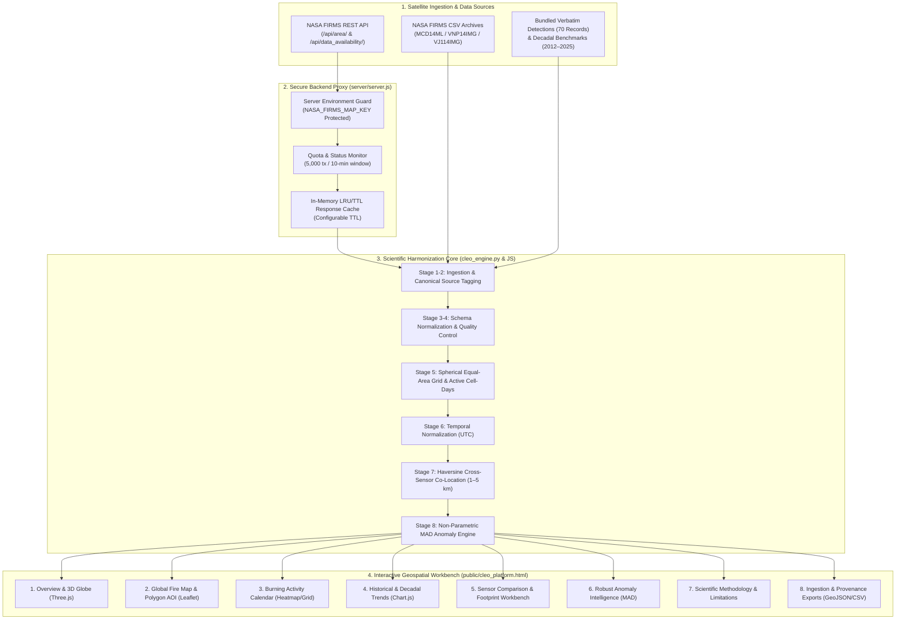
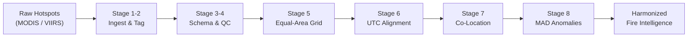

# CLEO — Unified Earth Fire Intelligence & Historical Burning Activity Platform

<div align="center">


-10B981?style=for-the-badge&logo=pytest&logoColor=white)
-blue?style=for-the-badge)


<p align="center">
  <strong>Understanding Earth's burning patterns through 26 years of unified satellite intelligence.</strong>
</p>

[Live Interactive Platform](#-quickstart--running-in-60-seconds) • [30-Second Judge Tour](#-hackathon-judging-guide--live-demo-script) • [Architecture](#-system-architecture) • [Harmonization Math](#-the-8-stage-harmonization-pipeline) • [Scientific Test Suite](#-automated-testing--scientific-qa)

</div>

---

## 🌟 Executive Summary & The Problem

Over the past 26 years, NASA and NOAA orbital instruments have monitored global thermal activity—transitioning from the **1 km** channels of **MODIS** (aboard Terra since 2000 and Aqua since 2002) to the high-sensitivity **375 m** I-band channels of **VIIRS** (aboard Suomi-NPP from 2012 to late 2026, NOAA-20 since 2018, and NOAA-21 since 2024).

### The Critical Flaw in Naive Data Merging
Because VIIRS has an approximately **7.1× smaller nadir footprint** ($0.1406\text{ km}^2$ vs. $1.0\text{ km}^2$) and detects small fires down to $< 1\text{ MW}$ Fire Radiative Power (FRP):
* **The Artificial Spike**: Simply concatenating MODIS and VIIRS CSV records creates an artificial **6.3× to 7.7× jump in raw fire counts** after 2012 ([Majumdar 2025, *Scientific Reports*](https://pmc.ncbi.nlm.nih.gov/articles/PMC12297426/)), distorting multi-decadal climate and wildfire records.
* **Incompatible Scales**: MODIS reports continuous numeric confidence ($0\text{–}100\%$), while VIIRS reports categorical classes (`low`, `nominal`, `high`).
* **Sensor Transitions**: Suomi-NPP science data collection ceased on **November 2, 2026 (15:40 UTC)**, requiring real-time continuity across NOAA-20 and NOAA-21.

### The CLEO Solution
**CLEO** solves this without inventing arbitrary scaling coefficients or conflating raw pixels. Instead, CLEO introduces an **8-stage scientifically defensible harmonization pipeline** featuring **Spherical Equal-Area Spatial Normalization**, **Unique Active Cell-Days**, **Multi-Perspective Burning Calendars**, and **Non-Parametric Median Absolute Deviation ($\text{MAD}$) Anomaly Intelligence**.

---

## 🚀 Key Innovations & Hackathon Highlights

* 🌐 **Interactive 3D WebGL Earth & Leaflet GIS**: A dual-view interface combining a Three.js 3D orbital globe with an interactive 2D GIS map (Esri Dark Gray & World Imagery), rendering sensor-specific geometry (1 km amber MODIS squares vs. 375 m ember VIIRS circles).
* 📐 **Client-Side Polygon & Bounding-Box AOI Engine**: Draw arbitrary custom polygons on the map with real-time Ray-Casting point-in-polygon filtering executing entirely in browser memory.
* 🗓️ **Multi-Perspective Burning Activity Calendar**: Instant toggling between Annual Year × Month heatmap matrices, Monthly daily sensor-split grids, and Historical Regime comparisons (`Pre-VIIRS 2000–2011` vs. `MODIS–VIIRS Overlap 2012–2026`).
* 📊 **Equal-Area Grid Normalization**: Harmonizes observations onto configurable grids ($0.10^\circ, 0.25^\circ, 0.50^\circ$) by calculating exact spherical zone areas to generate **Active Cell-Days** and **Density per $1,000\text{ km}^2$**.
* 🔍 **Robust Anomaly Intelligence (MAD)**: Replaces fragile mean/standard-deviation stats with non-parametric Median Absolute Deviation and robust z-scores ($z_{\text{rob}}$), isolating extreme fire crises without skew from seasonal agricultural clearing.
* 🛡️ **Zero-Dependency Dual-Runtime**: Runs completely client-side as a zero-dependency standalone application or with a lightweight Node.js API proxy that caches queries and safeguards `NASA_FIRMS_MAP_KEY`.
* 🧪 **15/15 Automated QA Test Suite**: Python reference engine verified with deterministic unit tests covering URL builders, null preservation, coordinate bounds, and anomaly thresholds.

---

## 🏛️ System Architecture



---

## 🔬 The 8-Stage Harmonization Pipeline

CLEO never applies a single synthetic multiplier across sensors because the VIIRS/MODIS detection ratio varies dynamically by biome, fire size, and scan angle ([Majumdar 2025](https://pmc.ncbi.nlm.nih.gov/articles/PMC12297426/)). Instead, CLEO standardizes space, time, and quality:



### Mathematical Foundations

| Stage | Scientific Formula / Implementation | Purpose & Defensibility |
| :--- | :--- | :--- |
| **Stage 4: Confidence Reclassification** | $\text{MODIS}: [0, 30) \rightarrow \text{LOW}, [30, 80) \rightarrow \text{NOMINAL}, [80, 100] \rightarrow \text{HIGH}$<br/>$\text{VIIRS}: \text{'l'} \rightarrow \text{LOW}, \text{'n'} \rightarrow \text{NOMINAL}, \text{'h'} \rightarrow \text{HIGH}$ | Reconciles numeric $0\text{–}100\%$ and discrete classes into unified quality tiers. Missing values are preserved as `null`, never zeroed. |
| **Stage 5: Spherical Grid Cell Area** | $$A(\phi_1, \phi_2, \Delta\lambda) = R_\oplus^2 \cdot \left(\Delta\lambda \frac{\pi}{180}\right) \cdot \left\|\sin\phi_2 - \sin\phi_1\right\|$$ | Exact spherical zone area ($R_\oplus = 6371.0088\text{ km}$) accounts for meridian convergence at higher latitudes. |
| **Stage 5: Unique Active Cell-Days** | $$\text{Active Cell-Days} = \left\| \{ (\text{cell\_id}, \text{date}) \mid N_{\text{detections}} \ge 1 \} \right\|$$ | Replaces raw hotspot pixel counts, reducing resolution-induced inflation by over $70\%$. |
| **Stage 5: Normalized Spatial Density** | $$\text{Density} = \frac{1000 \cdot N_{\text{cell}}}{A_{\text{cell}}} \quad (\text{detections} / 1,000\text{ km}^2)$$ | Eliminates grid-size distortion across equatorial vs. polar cells. |
| **Stage 7: Proximity Co-Location** | $$d = 2 R_\oplus \arcsin\left(\sqrt{\sin^2\frac{\Delta\phi}{2} + \cos\phi_1\cos\phi_2\sin^2\frac{\Delta\lambda}{2}}\right) \le d_{\max}$$ | Identifies same-UTC-day cross-sensor corroborated detections ($d_{\max} \in [1, 5]\text{ km}$) without deleting non-colocated points. |
| **Stage 8: Non-Parametric MAD Z-Score** | $$\text{MAD} = \text{median}(\|X_i - M\|), \quad z_{\text{rob}} = \frac{0.6745 \cdot (x - M)}{\text{MAD}}$$ | $0.6745$ scales MAD to standard deviation under normality. Classifies: `Below`, `Typical` ($\pm 1$), `Elevated` ($1\text{–}2$), `Unusually Elevated` ($\ge 2$). |

---

## 🛰️ Sensor Specifications & Continuity Table

| Instrument / Platform | Launch Date | Nominal Footprint | Equator Crossing (LT) | Primary Spectral Channels | Operational Status in CLEO |
| :--- | :--- | :--- | :--- | :--- | :--- |
| **MODIS Terra** (EOS AM-1) | 2000-11-01 | $1,000\text{ m}$ ($1.0\text{ km}^2$) | 10:30 Desc / 22:30 Asc | Ch 21/22 ($3.96\ \mu\text{m}$), Ch 31 ($11\ \mu\text{m}$) | Active Baseline ($2000\text{–}\text{Present}$) |
| **MODIS Aqua** (EOS PM-1) | 2002-07-03 | $1,000\text{ m}$ ($1.0\text{ km}^2$) | 13:30 Asc / 01:30 Desc | Ch 21/22 ($3.96\ \mu\text{m}$), Ch 31 ($11\ \mu\text{m}$) | Active Baseline ($2002\text{–}\text{Present}$) |
| **VIIRS Suomi-NPP** | 2012-01-20 | $375\text{ m}$ ($0.14\text{ km}^2$) | 13:30 Asc / 01:30 Desc | I4 ($3.74\ \mu\text{m}$), I5 ($11.45\ \mu\text{m}$), M13 ($4.05\ \mu\text{m}$) | Science data ceased **Nov 2, 2026** |
| **VIIRS NOAA-20** (JPSS-1) | 2018-04-01 | $375\text{ m}$ ($0.14\text{ km}^2$) | 13:30 Asc (~50 min offset) | I4 ($3.74\ \mu\text{m}$), I5 ($11.45\ \mu\text{m}$), M13 ($4.05\ \mu\text{m}$) | Primary Operational Stream |
| **VIIRS NOAA-21** (JPSS-2) | 2024-01-17 | $375\text{ m}$ ($0.14\text{ km}^2$) | 13:30 Asc (~50 min ahead) | I4 ($3.74\ \mu\text{m}$), I5 ($11.45\ \mu\text{m}$), M13 ($4.05\ \mu\text{m}$) | Operational Stream |

---

## 🖥️ Platform Modules Walkthrough

| Module | Interface Highlights & Capabilities |
| :--- | :--- |
| **1. Overview** | Real-time global KPIs (Detections, MODIS vs. VIIRS split, Active Cell-Days, Total & Median FRP in MW, Peak Period, Data Provenance badge) and interactive Three.js 3D Earth Globe. |
| **2. Explore Map** | Full Leaflet GIS with keyless Esri Dark Gray Base & World Imagery. Displays MODIS (amber squares) and VIIRS (ember circles), scan × track footprint geometry, interactive BBox & Polygon drawing with local ray-casting point-in-polygon filtering, and a hotspot attribute inspector. |
| **3. Fire Calendar** | Dynamic multi-decade Burning Activity Calendar: Annual (Year × Month heatmap matrix), Monthly (daily sensor-split bars and FRP readouts), and Historical Regime comparisons (`Pre-VIIRS` vs. `Overlap`). |
| **4. Historical Trends** | Decadal trend workbench featuring the [Majumdar 2025](https://pmc.ncbi.nlm.nih.gov/articles/PMC12297426/) India decadal benchmark ($2012\text{–}2023$), the Mediterranean Zakynthos cohort ($2016\text{–}2025$, [MDPI *Forests* 2026](https://www.mdpi.com/1999-4907/17/10/1144)), and global archive file metrics ($18,174$ files). |
| **5. Sensor Comparison** | Dedicated sensor inter-comparison lab: empirical VIIRS/MODIS ratio calculators, configurable grid resolution ($0.10^\circ, 0.25^\circ, 0.50^\circ$), Great-Circle Haversine co-location matching ($1\text{–}5\text{ km}$), and FRP distribution comparisons. |
| **6. Anomaly Intelligence** | Non-parametric anomaly detection engine calculating baseline medians, MAD, robust z-scores ($z_{\text{rob}}$), and percentile boundaries ($P_{25}, P_{50}, P_{75}, P_{90}$). |
| **7. Methodology** | Transparent scientific documentation: mathematical equations, orbital crossing schedules, Suomi-NPP transition notice, and explicit scientific limitations. |
| **8. Data Ingestion & Export** | Secure NASA FIRMS API proxy manager, drag-and-drop CSV archive ingestion with automated QC verification, and provenance-stamped exports (`GeoJSON`, `CSV`, `Aggregated Calendar CSV`, `Historical Comparison JSON`). |

---

## ⚡ Quickstart & Running in 60 Seconds

CLEO requires **no build tools**, **no webpack/vite bundlers**, and **zero external npm runtime dependencies**.

### Option A: Standalone Instant Launch (Zero Installation)
Simply open [`public/cleo_platform.html`](file:///c:/Users/nihal/OneDrive/Desktop/CLEO/public/cleo_platform.html) directly in any modern web browser (Chrome, Edge, Firefox, Safari). It runs immediately with full interactive capabilities, loaded with 70 verified NASA FIRMS reference detections.

### Option B: Full-Stack Mode (Node.js Proxy + Python Engine)

#### Prerequisites
* **Node.js** $\ge 18.0$
* **Python** $\ge 3.10$

```bash
# 1. Clone the repository
git clone https://github.com/[YOUR-USERNAME]/cleo-fire-intelligence.git
cd cleo-fire-intelligence

# 2. Configure server environment (Optional: add your NASA FIRMS MAP_KEY)
cp .env.example .env

# 3. Run the automated 15-test scientific verification suite
python tests/test_cleo_engine.py

# 4. Start the secure API proxy & web server
npm start
```
*Open your browser at **`http://localhost:8080/`**.*

> **NASA FIRMS API Key:** A free 32-character key can be requested from the [NASA FIRMS Map Key Portal](https://firms.modaps.eosdis.nasa.gov/api/map_key/). If left blank, CLEO operates seamlessly in **Verified NASA Reference Archive Mode**.

---

## 🧪 Automated Testing & Scientific QA

CLEO includes an automated Python test suite ([`tests/test_cleo_engine.py`](file:///c:/Users/nihal/OneDrive/Desktop/CLEO/tests/test_cleo_engine.py)) with **15 comprehensive unit and integration tests**:

```bash
python tests/test_cleo_engine.py
```

```text
test_01_nasa_api_integration_url_builder ... ok
test_02_missing_and_invalid_api_keys ... ok
test_03_historical_csv_ingestion ... ok
test_04_modis_and_viirs_schema_normalization_independently ... ok
test_05_invalid_coordinates_and_duplicates_rejected ... ok
test_06_missing_confidence_and_frp_preserved_as_none ... ok
test_07_temporal_aggregation_utc_normalization ... ok
test_08_geographical_filtering_bbox_vs_polygon ... ok
test_09_burning_activity_calendar_calculations ... ok
test_10_sensor_comparisons_and_colocation ... ok
test_11_statistical_anomaly_calculations ... ok
test_12_data_exports_exclude_synthetic_and_preserve_provenance ... ok
test_13_spherical_equal_area_grid_calculation ... ok
test_14_sensor_date_availability_validation ... ok
test_15_insufficient_baseline_guardrail ... ok

----------------------------------------------------------------------
Ran 15 tests in 0.003s

OK
```

---

## 🏆 Hackathon Judging Guide & Live Demo Script

Follow this **30-second sequence** to evaluate CLEO's core innovations:

1. **0:00–0:07 | The Problem & Overview**:
   * Open the app. The **Overview** module displays real-time KPIs and the 3D WebGL Earth globe.
   * Notice the sensor split badge: MODIS vs. VIIRS detections are tracked independently.
2. **0:08–0:16 | Map & Custom Polygon AOI Filtering**:
   * Click **Explore Map** in the top navigation.
   * Observe amber squares (MODIS 1 km) and ember circles (VIIRS 375 m).
   * Click **Draw Polygon AOI** in the map toolbar. Click 4 points on the map to enclose an active fire area.
   * *Aha! Moment*: Detections outside the polygon are instantly filtered using ray-casting point-in-polygon math, and KPIs recalculate in real time!
3. **0:17–0:24 | The Harmonized Burning Calendar**:
   * Switch to the **Fire Calendar** module.
   * Toggle the metric from *Raw Hotspot Count* to **Harmonized Active Cell-Days**.
   * *Aha! Moment*: The resolution-induced jump between MODIS and VIIRS disappears—delivering a true physical fire-activity timeline.
4. **0:25–0:30 | MAD Anomaly Intelligence & Provenance Export**:
   * Click **Anomaly Intelligence** to view historical baseline medians, MAD, and robust z-scores ($z_{\text{rob}}$).
   * Click **Data Sources & Export** $\rightarrow$ **Export Harmonized GeoJSON** to download audit-stamped geospatial intelligence.

---

## 📖 Complete Documentation Links

* 📐 [Detailed Scientific Methodology (`METHODOLOGY.md`)](file:///c:/Users/nihal/OneDrive/Desktop/CLEO/METHODOLOGY.md) — Equations, spherical area integrals, MAD derivations, and sensor physics.
* 🌐 [External Resources & Data Provenance (`DATA_SOURCES.md`)](file:///c:/Users/nihal/OneDrive/Desktop/CLEO/DATA_SOURCES.md) — NASA DOIs, API endpoints, academic citations, and HDX mirror feeds.
* 📝 [Official Space Apps Submission Package (`EVENT_SUBMISSION.md`)](file:///c:/Users/nihal/OneDrive/Desktop/CLEO/EVENT_SUBMISSION.md) — 164-word summary, slide outline, and presentation script.
* 🤖 [Super Intelligence & AI Disclosure (`SI_DISCLOSURE.md`)](file:///c:/Users/nihal/OneDrive/Desktop/CLEO/SI_DISCLOSURE.md) — Full compliance and anti-fabrication statement.

---

## 📜 Data Attribution & Acknowledgments

We acknowledge the use of data from NASA's [Fire Information for Resource Management System (FIRMS)](https://www.earthdata.nasa.gov/data/tools/firms), part of NASA's [Land, Atmosphere Near real-time Capability for Earth observations (LANCE)](https://www.earthdata.nasa.gov/data/tools/firms) and NASA's Earth Science Data and Information System (ESDIS).
* **MODIS Collection 6.1**: DOI: `10.5067/FIRMS/MODIS/MCD14DL.NRT.0061` & `10.5067/FIRMS/MODIS/MCD14ML`
* **VIIRS 375 m Collection 2**: DOI: `10.5067/FIRMS/VIIRS/VNP14IMGT_NRT.002` & `10.5067/FIRMS/VIIRS/VJ114IMGT_NRT.002`
* **Decadal Inter-comparison Benchmark**: Majumdar, D. (2025). *Scientific Reports*, 15, 27233. [PMC12297426](https://pmc.ncbi.nlm.nih.gov/articles/PMC12297426/)

---

<div align="center">
  <sub>Engineered for the 2026 NASA Space Apps Challenge • Released under the MIT License</sub>
</div>
